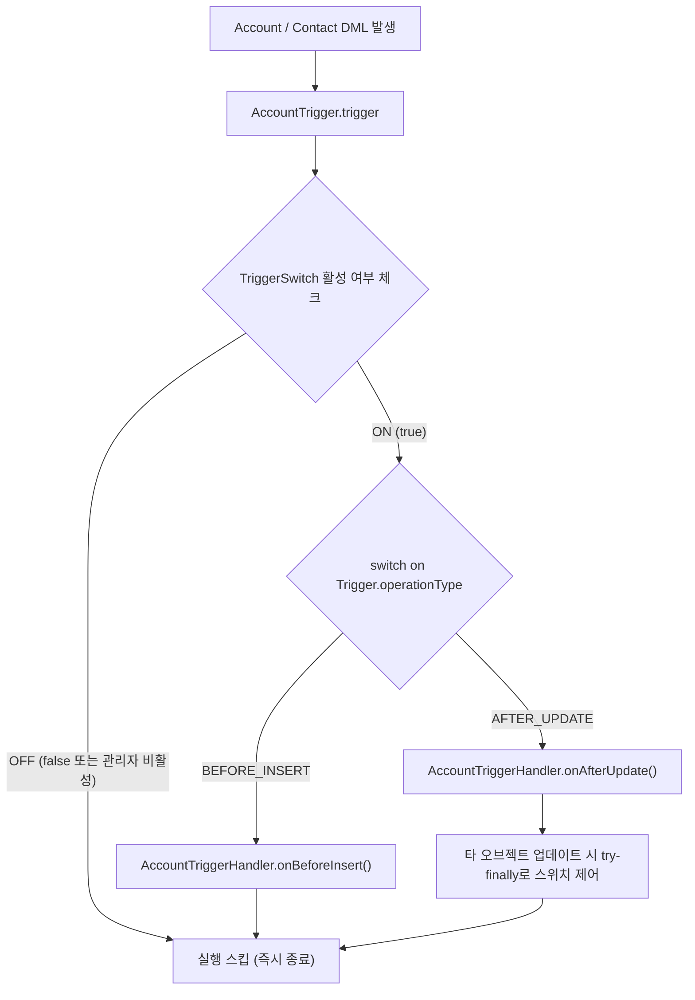

## 서론: 왜 Salesforce에서만 유독 SOQL 101, DML 150 에러가 날까?

일반 Java/Spring 웹 개발을 하다가 Salesforce(Apex) 프로젝트를 처음 접하면 가장 먼저 마주치는 당황스러운 런타임 에러가 있습니다. 바로 데이터 로더(Data Loader)나 배치로 수천 건의 데이터를 밀어 넣을 때 터지는 **Governor Limits(거버너 리밋)** 예외입니다.

```text
System.LimitException: Too many SOQL queries: 101
System.LimitException: Too many DML statements: 151
System.LimitException: Maximum trigger depth exceeded
```

왜 Salesforce는 쿼리 횟수와 DML 횟수를 이렇게 빡빡하게 제한할까요? 정답은 Salesforce의 핵심 기반인 **멀티테넌트(Multi-Tenant, 다중 입주자) 아키텍처**에 있습니다.

- **일반 자체 서버 / AWS (단독주택)**: 개발자가 실수로 `for`문 안에서 DB 쿼리를 10,000번 날려도 우리 회사 서버만 느려지고 끝납니다.
- **Salesforce 환경 (아파트 한 동 공유)**: 하나의 거대한 물리 서버와 DB 자원을 수백~수천 개의 고객사(Org)가 함께 나눠 씁니다. 특정 고객사의 잘못된 코드가 자원을 독점해 다른 고객사 화면까지 멈추는 현상(Noisy Neighbor)을 막기 위해, **1회 트랜잭션당 SOQL 조회 100회, DML 150회**라는 엄격한 상한선을 강제하는 것입니다.

이번 글에서는 거창하고 무거운 이론 대신, **실제 현업 프로젝트에서 가장 많이 사용하는 직관적인 `Trigger + TriggerHandler + TriggerSwitch` 설계 패턴**과 대량 데이터 처리(**Bulkification**) 시 놓치기 쉬운 실전 함정들을 정리해 보겠습니다.

---

## 1. 실무 Apex Trigger 설계의 3대 원칙

1. **One Trigger Per Object (오브젝트당 트리거는 단 하나만)**
   - `Account`에 `AccountTrigger1`, `AccountTrigger2`처럼 여러 개의 트리거 파일을 만들면 Salesforce는 **어느 트리거가 먼저 실행될지 순서를 보장하지 않습니다.**
   - 유지보수와 디버깅을 위해 오브젝트당 딱 하나의 `.trigger` 파일만 만듭니다.
2. **Trigger는 '분기'만, 실제 작업은 'Handler'에서**
   - `.trigger` 파일 안에 비즈니스 로직을 직접 적지 않습니다. 트리거는 현재 실행 타이밍(`before insert`, `after update` 등)만 판단해서 `AccountTriggerHandler`의 메서드를 호출하는 라우터 역할만 맡습니다.
3. **무조건 200건이 동시에 들어온다고 가정하기 (Bulkification)**
   - 화면에서 레코드 1건을 저장할 때나 Data Loader로 10,000건을 수정할 때나 똑같은 트리거가 실행됩니다. (10,000건 입력 시 **200건 단위 청크(Chunk)**로 나뉘어 실행됨)
   - 따라서 `Trigger.new`는 단건이 아니라 **항상 최대 200개짜리 리스트**라는 전제로 코드를 짜야 합니다.

---

## 2. Bulkification: 안티 패턴(Bad) vs 실무 표준(Good)

`Account`의 대표 전화번호(`Phone`)가 바뀌었을 때 하위 `Contact`들의 전화번호를 함께 업데이트하는 흔한 실무 요건으로 비교해 보겠습니다.

### ⚠️ Bad Case: 루프(for문) 내부에서 SOQL 및 DML 호출

```apex
public class BadAccountHandler {
    public static void afterUpdate(List<Account> newList) {
        for (Account acc : newList) {
            // ❌ 1. 루프 내부 SOQL: 200건 인입 시 101번째에서 즉시 에러 발생!
            List<Contact> contacts = [SELECT Id, Phone FROM Contact WHERE AccountId = :acc.Id];

            for (Contact con : contacts) {
                con.Phone = acc.Phone;
                // ❌ 2. 루프 내부 DML: 151번째에서 즉시 트랜잭션 전체 롤백!
                update con;
            }
        }
    }
}
```

> 화면에서 테스트로 1건만 수정할 때는 아무 에러 없이 잘 돌아가기 때문에 초급 개발자가 운영 배포 후 대형 장애를 내기 가장 쉬운 코드입니다.
{: .prompt-danger }

### ✅ Good Case: Set / Map 컬렉션으로 SOQL 1회, DML 1회 처리

```apex
public with sharing class AccountTriggerHandler {

    public static void onAfterUpdate(List<Account> newList, Map<Id, Account> oldMap) {
        Set<Id> changedAccountIds = new Set<Id>();

        // 1. 실제로 전화번호가 변경된 Account ID만 추출 (불필요한 쿼리 방지)
        for (Account acc : newList) {
            Account oldAcc = oldMap.get(acc.Id);
            if (acc.Phone != oldAcc.Phone) {
                changedAccountIds.add(acc.Id);
            }
        }

        // 변경된 대상이 없으면 즉시 종료 (Early Return)
        if (changedAccountIds.isEmpty()) {
            return;
        }

        // 2. for문 바깥에서 단 1번의 SOQL로 관련 Contact 일괄 조회
        List<Contact> contactsToUpdate = [
            SELECT Id, Phone, AccountId
            FROM Contact
            WHERE AccountId IN :changedAccountIds
            WITH USER_MODE
        ];

        if (contactsToUpdate.isEmpty()) {
            return;
        }

        // 3. Map을 활용해 메모리 상에서 빠르게 매핑 (이중 루프 방지)
        Map<Id, Account> newAccountMap = new Map<Id, Account>(newList);
        for (Contact con : contactsToUpdate) {
            Account parentAcc = newAccountMap.get(con.AccountId);
            if (parentAcc != null) {
                con.Phone = parentAcc.Phone;
            }
        }

        // 4. for문 바깥에서 단 1번의 DML로 일괄 업데이트
        update as user contactsToUpdate;
    }
}
```

---

## 3. 현업에서 가장 선호하는 직관적 구조: `Trigger + Handler + TriggerSwitch`

해외 아키텍처 문서들을 보면 처음부터 복잡한 상속 구조로 거대한 프레임워크를 구축하곤 하지만, 실제 현업 프로젝트에서는 **누가 봐도 흐름이 한눈에 보이고 디버깅이 쉬운 `Trigger(분기) + Handler(로직) + TriggerSwitch(제어 스위치)` 3단 조합**을 가장 많이 사용합니다.

전체 호출 및 연쇄 제어 흐름을 다이어그램으로 보면 다음과 같습니다.



### 1) 공용 스위치 클래스 (`TriggerSwitch.cls`)

예를 들어 `Contact` 트리거가 돌면서 부모 `Account`의 요약 필드를 업데이트해야 하는데, 이때 **`Account` 트리거까지 연쇄적으로 돌아버리면 안 되는 상황(무한 루프 또는 불필요한 로직 실행)**이 실무에서 정말 자주 발생합니다. 이때 공용 스위치 클래스 하나면 아주 깔끔하게 해결됩니다.

```apex
/**
 * @description 트랜잭션 내 트리거 실행 여부를 제어하는 공용 스위치 클래스
 */
public class TriggerSwitch {
    // 기본값은 모두 true (활성 상태)
    public static Boolean runAccountTrigger = true;
    public static Boolean runContactTrigger = true;
    public static Boolean runOpportunityTrigger = true;

    /**
     * 코드 내 static 스위치와 관리자용 Custom Setting(무배포 제어)을 함께 체크
     */
    public static Boolean isAccountActive() {
        // 운영 환경에서 긴급 데이터 적재 시 관리자 체크박스로도 끌 수 있도록 결합 가능
        Trigger_Bypass_Setting__c adminSetting = Trigger_Bypass_Setting__c.getInstance();
        if (adminSetting != null && adminSetting.Bypass_Account__c) {
            return false;
        }
        return runAccountTrigger;
    }
}
```

> **왜 `global`이 아니라 `public static`을 쓸까요?**
> Apex에서 `global` 접근 제어자는 외부 패키지(AppExchange) 공개용이라 한 번 배포하면 변수명 수정이나 삭제가 까다롭습니다. 일반 프로젝트 내 공용 클래스는 `public`으로 충분합니다. 또한 Apex의 `static` 변수는 Java 서버와 달리 **현재 실행 중인 단일 트랜잭션 안에서만 메모리에 유지**되고 트랜잭션이 끝나면 자동 소멸하므로, 다른 사용자의 요청에 절대 영향을 주지 않아 안전합니다.
{: .prompt-info }

### 2) 깔끔하게 분기만 담당하는 `AccountTrigger.trigger`

Apex에 도입된 `Trigger.operationType` 열거형(`switch on`)을 사용하면 `if (Trigger.isBefore && Trigger.isInsert)` 조건문을 지저분하게 나열할 필요 없이 가독성이 극대화됩니다.

```apex
trigger AccountTrigger on Account (
    before insert, before update, before delete,
    after insert, after update, after delete, after undelete
) {
    // 공용 스위치가 꺼져 있으면 즉시 종료
    if (!TriggerSwitch.isAccountActive()) {
        return;
    }

    // 트리거에서는 오직 컨텍스트 분기만 수행하고 Handler로 위임
    switch on Trigger.operationType {
        when BEFORE_INSERT {
            AccountTriggerHandler.onBeforeInsert(Trigger.new);
        }
        when BEFORE_UPDATE {
            AccountTriggerHandler.onBeforeUpdate(Trigger.new, Trigger.oldMap);
        }
        when AFTER_INSERT {
            AccountTriggerHandler.onAfterInsert(Trigger.new, Trigger.newMap);
        }
        when AFTER_UPDATE {
            AccountTriggerHandler.onAfterUpdate(Trigger.new, Trigger.oldMap);
        }
    }
}
```

### 3) ⭐ 실무 핵심 디테일: 타 오브젝트에서 스위치 끌 때는 반드시 `try ~ finally`로 복구하기!

`ContactTriggerHandler`에서 `Account`를 업데이트할 때 `AccountTrigger`가 돌지 않도록 `TriggerSwitch.runAccountTrigger = false;`로 끄는 패턴은 매우 유용합니다. **단, 반드시 `try ~ finally` 블록으로 다시 `true`로 돌려놓아야 합니다!**

```apex
public with sharing class ContactTriggerHandler {

    public static void onAfterUpdate(List<Contact> newContacts, Map<Id, Contact> oldMap) {
        List<Account> accountsToUpdate = new List<Account>();
        // ... 업데이트할 부모 Account 목록 세팅 로직 ...

        if (!accountsToUpdate.isEmpty()) {
            // Contact 작업으로 인해 AccountTrigger가 연쇄 실행되지 않도록 잠시 OFF
            TriggerSwitch.runAccountTrigger = false;
            try {
                update as user accountsToUpdate;
            } finally {
                // ✅ 핵심: DML이 끝나거나 예외가 나더라도 반드시 다시 true로 원상복구!
                TriggerSwitch.runAccountTrigger = true;
            }
        }
    }
}
```

> **왜 `finally`로 다시 켜줘야 할까요? (200건 청크 실행의 함정)**
> 만약 한 트랜잭션에서 400건의 데이터를 처리하면 Salesforce는 **1차(1~200번) 실행 후 같은 트랜잭션 안에서 곧바로 2차(201~400번) 트리거를 실행**합니다. 이때 `static` 변수는 초기화되지 않고 유지되므로, 1차 실행에서 스위치를 `false`로 끄기만 하고 다시 켜주지 않으면 **201번째 이후 레코드들은 정작 돌아야 할 트리거까지 통째로 씹혀버리는 치명적인 데이터 누락 버그**가 발생합니다!
{: .prompt-warning }

---

## 4. 참고: `extends TriggerHandler` (`virtual class`) 프레임워크는 왜 쓰는 걸까?

일부 대형 프로젝트나 오픈소스 예제(예: `sfdc-trigger-framework`)를 보면 `AccountTriggerHandler extends TriggerHandler`처럼 부모 클래스를 상속받아 `override` 하는 방식을 보신 적이 있을 겁니다. 그리고 그 부모 파일을 열어보면 평소 잘 안 쓰는 **`public virtual class TriggerHandler`** 키워드가 등장합니다.

- **왜 `virtual class`가 붙어 있을까?**
  Java와 달리 **Apex의 모든 클래스는 기본적으로 `final`(상속 불가)**입니다. 따라서 공통 프레임워크를 만드는 초기 아키텍트가 부모 클래스에 `virtual` 키워드와 `protected virtual void afterUpdate() {}`를 선언해 두어야만 개발자들이 `extends TriggerHandler`로 상속받아 필요한 메서드만 `override` 할 수 있습니다. (우리가 Spring Boot에서 내부 추상 클래스 코드는 안 열어보고 어노테이션만 가져다 쓰는 것과 같은 원리입니다.)

### 우리 프로젝트에는 어떤 방식이 맞을까?

| 비교 항목 | 실속형 (`switch on` + `TriggerSwitch`) | 프레임워크 상속형 (`extends TriggerHandler`) |
| :--- | :--- | :--- |
| **구조 복잡도** | 매우 심플하고 직관적 (`Ctrl + 클릭`으로 즉시 이동) | 기반 `virtual class` 이해 필요 |
| **유지보수 / 디버깅** | 호출 스택이 짧아 디버깅 로그 추적이 빠름 | 공통 로직(로깅, 루프 횟수 제한) 일괄 적용에 유리 |
| **추천 프로젝트 규모** | **대부분의 일반 구축 / 인하우스 프로젝트 (추천)** | 커스텀 오브젝트 50~100개 이상의 초대형 글로벌 Org |

오브젝트 수가 수십~수백 개인 초대형 시스템에서 모든 트리거에 공통 감사 로그나 실행 횟수 제한을 강제해야 하는 경우가 아니라면, **과잉 설계(Over-engineering) 없이 `Trigger(분기) + Handler(로직) + TriggerSwitch(스위치)` 구조로 구성하는 것이 현업 생산성과 유지보수 면에서 훨씬 유리**합니다.

---

## 5. 주요 Governor Limits 요약 & 배포 전 체크리스트

| 제한 항목 (Limit) | 동기(Synchronous) | 비동기(Async) | 실무 예방 수칙 |
| :--- | :--- | :--- | :--- |
| **SOQL 쿼리 횟수** | **100회** | 200회 | `for`문 내부 쿼리 절대 금지, `Set<Id>` + `IN` 절 사용 |
| **DML 호출 횟수** | **150회** | 150회 | 단건 DML 금지, `List<SObject>`에 담아 루프 밖에서 일괄 처리 |
| **DML 처리 레코드 수** | **10,000건** | 10,000건 | 1만 건 초과 작업은 `Batch Apex` 또는 `Queueable`로 분리 |
| **CPU Time** | **10,000 ms** | 60,000 ms | 이중 `for`문 대신 `Map<Id, SObject>` 조회(`O(1)`) 사용 |

> **배포 전 셀프 코드 리뷰 체크리스트**
> - [ ] 해당 오브젝트에 `.trigger` 파일이 단 하나만 존재하는가?
> - [ ] `.trigger` 파일에는 컨텍스트 분기(`switch on`)와 스위치 체크만 있고 비즈니스 로직이 분리되어 있는가?
> - [ ] `for`문 내부에 SOQL이나 DML이 단 한 줄도 없는가?
> - [ ] `oldMap`과 비교하여 **실제로 관심 필드가 변경된 레코드**만 추려서 후속 처리를 수행하는가?
> - [ ] `TriggerSwitch`를 코드에서 `false`로 변경한 경우, 반드시 `try ~ finally`로 원상복구했는가?
> - [ ] 테스트 클래스에서 단건이 아닌 **200건 대량 데이터 Insert/Update 테스트**를 검증했는가?
{: .prompt-tip }

---

## 마무리 및 다음 편 예고

깔끔한 트리거 설계의 본질은 화려한 디자인 패턴이 아니라 **"실행 순서 보장, 대량 데이터(200건 청크) 안전성, 그리고 예측 가능한 연쇄 실행 제어"**에 있습니다. 오늘 정리한 `Trigger + Handler + TriggerSwitch` 패턴만 일관되게 지켜도 실무에서 마주치는 대부분의 Governor Limit 장애와 무한 루프 이슈를 깔끔하게 예방할 수 있습니다.

**다음 편 예고:**
> 트리거 안에서 외부 API(Callout)를 호출하거나 10,000건 이상의 대용량 데이터를 처리해야 할 때는 어떻게 해야 할까요? 다음 편에서는 **`비동기 Apex 완전 정복: @future, Queueable, Batch Apex 선택 기준과 실무 체이닝 패턴`**을 다룹니다.
