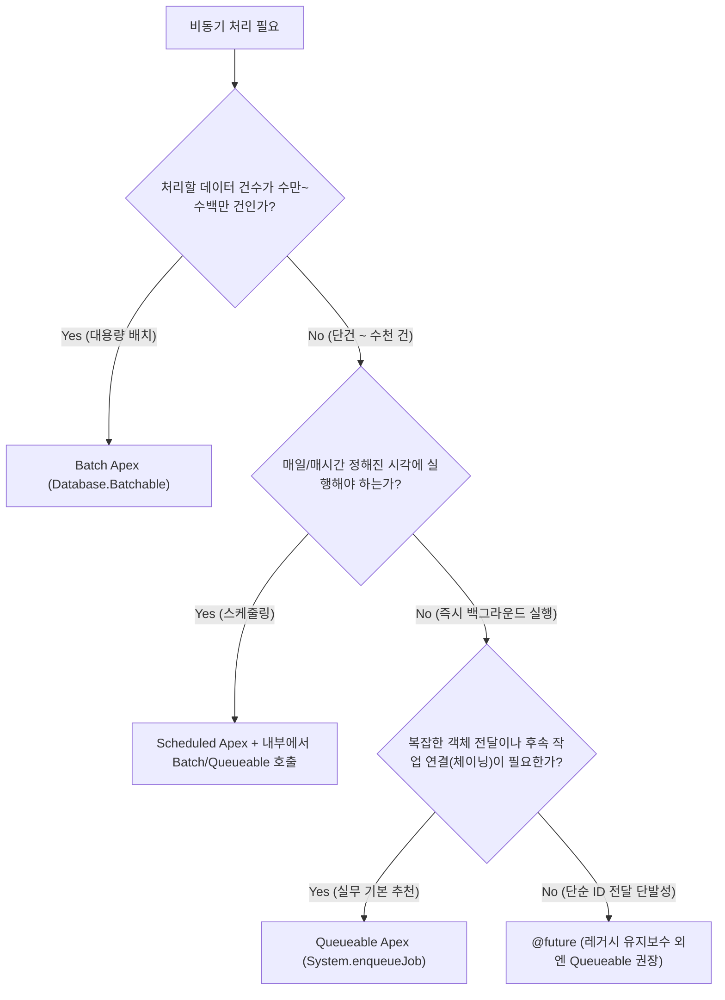

## 서론: 동기(Trigger)만으로는 해결 안 되는 3가지 실무 순간

[지난 1편 포스트](/posts/salesforce-apex-trigger-framework-best-practices/)에서 다룬 것처럼 `Trigger`와 `Handler`를 아무리 깔끔하게 Bulkification 해두더라도, 프로젝트를 진행하다 보면 **동기(Synchronous) 트랜잭션 안에서는 절대 처리할 수 없는 벽**을 마주치게 됩니다.

실무에서 비동기(Asynchronous) Apex를 꺼내 들어야 하는 대표적인 상황은 딱 3가지입니다.

1. **트리거에서 외부 시스템 API(Callout)를 호출해야 할 때**
   - 고객이나 주문 레코드가 저장된 직후 ERP나 알림톡/Slack API를 호출하려고 트리거 안에서 `Http.send()`를 실행하면 곧바로 아래 에러가 터집니다.
   ```text
   System.CalloutException: Callout from triggers are currently not supported.
   ```
   - 설령 일반 클래스에서 호출하더라도 같은 트랜잭션 안에서 DML(`insert`/`update`)을 먼저 실행한 직후 Callout을 날리면 유명한 `You have uncommitted work pending` 에러가 발생합니다.
2. **처리할 데이터가 10,000건(DML 한도) / 50,000건(SOQL 조회 한도)을 넘어갈 때**
   - 야간 정산이나 마이그레이션처럼 수십만~수백만 건의 레코드를 한 번에 돌려야 할 때는 트랜잭션을 여러 개로 쪼개서 돌리는 배치가 필수입니다.
3. **사용자 화면 응답 속도(UX) 확보**
   - 저장 버튼을 눌렀는데 복잡한 집계 연산 때문에 화면 로딩 스피너가 5~10초씩 돌면 현업 사용자 불만이 바로 접수됩니다. 당장 화면에 보여줄 필요 없는 후속 작업은 비동기 백그라운드로 넘겨야 합니다.

이번 글에서는 비동기 Apex 4종 세트(`@future`, `Queueable`, `Batch`, `Schedulable`) 중 **왜 요즘 실무에서 `@future` 대신 `Queueable`이 표준이 되었는지(체이닝 문제 포함)**와, **`Batch Apex` 운영 시 가장 자주 터지는 실전 함정**들을 정리합니다.

---

## 1. 한눈에 보는 비동기 Apex 4종 선택 기준

먼저 어떤 상황에 무엇을 써야 하는지 실무 기준으로 딱 정해두고 시작하겠습니다.



| 구분 | `@future` | `Queueable Apex` (실무 주력) | `Batch Apex` | `Scheduled Apex` |
| :--- | :--- | :--- | :--- | :--- |
| **파라미터 전달** | 원시 타입만 가능 (`Set<Id>`, `String` 등) | **`List<SObject>`, 커스텀 DTO 클래스 모두 가능** | 생성자로 모두 전달 가능 | 생성자/멤버 변수 활용 |
| **연쇄 실행 (Chaining)** | **불가 ❌** (`@future` 안에서 `@future` 호출 에러) | **가능 ⭕** (`execute` 안에서 다음 Job 연결) | **가능 ⭕** (`finish`에서 다음 Batch/Queueable 연결) | 스케줄 등록용 |
| **작업 추적 (Job ID)** | 불가 (`void` 반환) | **`Id` 반환** (`AsyncApexJob` 조회 가능) | **`Id` 반환** | **`Id` 반환** |
| **주요 용도** | 아주 단순한 비동기 처리 (과거 코드) | **트리거 후속 API 연동, 순차 비동기 파이프라인** | **1만 건 이상 대용량 데이터 일괄 처리** | 야간/주기적 자동 실행 |

---

## 2. 왜 실무에서 `@future`를 쓰면 발목이 잡힐까? (체이닝 불가와 배치 충돌)

예전 Salesforce 프로젝트 코드를 보면 어노테이션 한 줄(`@future(callout=true)`)만 붙이면 끝나는 간편함 때문에 `@future`를 정말 많이 썼습니다. 하지만 실무 요건이 조금만 복잡해지면 **치명적인 2가지 벽**에 부딪힙니다.

### 함정 1) `@future` 안에서는 다른 `@future`를 부를 수 없다 (체이닝 불가!)

예를 들어 외부 시스템 연동 시 **"1차로 토큰 발급/고객 등록 API를 쏘고 → 성공하면 이어서 2차로 주문 상세 API를 쏘는 작업"**을 연결(Chaining)하고 싶을 때, `@future` 메서드 안에서 또 다른 `@future` 메서드를 호출하면 즉시 아래 예외가 발생합니다.

```text
System.AsyncException: Future method cannot be called from a future or batch method
```

### 함정 2) 야간 `Batch`가 돌 때 트리거 안의 `@future`가 터진다!

현업에서 가장 흔하게 겪는 장애 시나리오입니다.
1. 개발자 A가 `OrderTriggerHandler`에서 주문 수정 시 ERP로 전송하려고 `@future` 메서드를 호출하게 만들어 두었습니다. (화면에서 저장할 땐 아주 잘 돌아갑니다!)
2. 몇 달 뒤 개발자 B가 야간에 미정산 주문을 일괄 업데이트하는 **`Batch Apex`**를 만들어 돌렸습니다.
3. 배치가 주문을 `update` 하는 순간 `OrderTrigger`가 실행되고, 이미 배치(비동기) 컨텍스트인데 그 안에서 `@future`를 호출하면서 **`Future method cannot be called from a future or batch method` 에러와 함께 야간 배치가 통째로 실패**합니다.

```apex
// ⚠️ 과거 @future 사용 시 어쩔 수 없이 덕지덕지 붙이던 방어 코드
if (!System.isFuture() && !System.isBatch()) {
    LegacyErpService.sendOrderFuture(orderIds); // 배치에서 돌 땐 아예 스킵되어 데이터 누락 위험!
}
```

게다가 `@future`는 파라미터로 `List<Order>` 같은 SObject 리스트나 직접 만든 Wrapper 클래스를 넘길 수 없어서, 굳이 `Set<Id>`만 넘겨서 다시 SOQL로 조회하거나 `JSON.serialize()`로 문자열로 변환해 넘기는 번거로운 꼼수를 써야 했습니다.

---

## 3. 실무 표준 해결사: `Queueable Apex`와 안전한 체이닝 패턴

위에서 겪은 `@future`의 모든 단점을 해결하기 위해 나온 상위 호환이 바로 **`Queueable` 인터페이스**입니다. 현업에서 새로 비동기 로직을 짠다면 특별한 이유가 없는 한 `@future` 대신 무조건 `Queueable`로 작성하는 것이 좋습니다.

### ✅ 실전 예제: 1차 연동 후 2차 후속 작업을 체이닝(Chaining)하는 `Queueable`

```apex
/**
 * @description 주문 생성/수정 후 외부 ERP 연동 및 후속 알림 작업을 처리하는 Queueable 클래스
 */
public class OrderErpSyncQueueable implements Queueable, Database.AllowsCallouts {

    private List<Order> targetOrders;

    // 1. @future와 달리 생성자를 통해 SObject 리스트나 커스텀 DTO를 그대로 받을 수 있음!
    public OrderErpSyncQueueable(List<Order> targetOrders) {
        this.targetOrders = targetOrders;
    }

    public void execute(QueueableContext context) {
        // 실패 복구 및 에러 로깅을 위한 Finalizer 부착 (선택적이지만 실무 강추!)
        System.attachFinalizer(new ErpSyncFinalizer(this.targetOrders));

        // 2. 외부 ERP API Callout 실행 (별도 비동기 트랜잭션이므로 DML 이후여도 안전)
        Http http = new Http();
        HttpRequest req = new HttpRequest();
        req.setEndpoint('callout:ERP_Named_Credential/api/v1/orders');
        req.setMethod('POST');
        req.setHeader('Content-Type', 'application/json');
        req.setBody(JSON.serialize(this.targetOrders));

        HttpResponse res = http.send(req);
        if (res.getStatusCode() != 200) {
            throw new CalloutException('ERP 전송 실패: Status ' + res.getStatusCode());
        }

        // 3. 연동 완료 상태 DB 반영
        List<Order> ordersToUpdate = new List<Order>();
        for (Order ord : this.targetOrders) {
            ordersToUpdate.add(new Order(Id = ord.Id, Description = 'ERP Synced'));
        }
        update as user ordersToUpdate;

        // 4. ⭐ 핵심: 후속 2차 비동기 작업(예: 알림톡 발송 Queueable) 체이닝 연결!
        if (!Test.isRunningTest()) {
            System.enqueueJob(new KakaoAlimtalkQueueable(this.targetOrders));
        }
    }
}
```

트리거 핸들러에서 호출할 때는 단 한 줄이면 되고, 반환받은 `jobId`로 진행 상태까지 조회할 수 있습니다.

```apex
// TriggerHandler 내부에서 호출 시
Id jobId = System.enqueueJob(new OrderErpSyncQueueable(changedOrders));
```

### 💡 실무자가 꼭 알아야 할 `Queueable` 디테일 2가지!

> **1. 테스트 클래스 에러 방지: 체이닝 앞에는 반드시 `if (!Test.isRunningTest())` 붙이기!**
> Apex 단위 테스트에서 `Test.stopTest()`가 실행될 때 비동기 작업이 동기로 즉시 실행되는데, 테스트 컨텍스트에서는 Queueable이 또 다른 Queueable을 부르는 연쇄 체이닝이 허용되지 않아 **`System.AsyncException: Maximum stack depth has been reached`** 에러가 납니다. 따라서 체이닝 호출부에는 `!Test.isRunningTest()`(또는 테스트용 스위치 변수)로 감싸두고, 2차 Queueable은 별도 테스트 메서드에서 단독 검증하는 것이 현업 국룰입니다.
{: .prompt-warning }

> **2. 조용히 묻히는 비동기 에러 잡기: `System.Finalizer` 활용**
> 비동기 작업은 백그라운드에서 돌기 때문에 예외가 터져도 사용자 화면에 에러 창이 뜨지 않습니다. 아래처럼 `Finalizer`를 붙여두면 **Callout 타임아웃이나 심지어 미처리 Limit 에러로 죽더라도 무조건 `execute`가 호출**되어 실패 로그 오브젝트(`Error_Log__c`)에 안전하게 기록을 남기거나 재시도(Retry) 큐를 태울 수 있습니다!
{: .prompt-tip }

```apex
public class ErpSyncFinalizer implements Finalizer {
    private List<Order> orders;

    public ErpSyncFinalizer(List<Order> orders) {
        this.orders = orders;
    }

    public void execute(FinalizerContext ctx) {
        if (ctx.getResult() == ParentJobResult.UNHANDLED_EXCEPTION) {
            Exception ex = ctx.getException();
            // 비동기 본체 트랜잭션이 롤백되더라도 이 안의 에러 로그 저장 DML은 별도로 정상 커밋됨!
            insert new Error_Log__c(
                Source__c = 'OrderErpSyncQueueable',
                Job_Id__c = String.valueOf(ctx.getAsyncApexJobId()),
                Message__c = ex.getMessage(),
                StackTrace__c = ex.getStackTraceString()
            );
        }
    }
}
```

---

## 4. 대용량 처리의 정석: `Batch Apex` 구조와 실전 함정 2가지

데이터가 수만 건~수천만 건 단위로 넘어가면 한 번의 `Queueable` 트랜잭션(SOQL 조회 5만 건, DML 1만 건 한도)으로도 감당할 수 없습니다. 이때 사용하는 것이 **`Database.Batchable`**입니다.

- **`start()`**: `Database.QueryLocator`를 통해 최대 **5,000만 건**까지 대상을 추출합니다.
- **`execute()`**: 지정한 배치 사이즈(기본값 **200건**) 단위로 데이터를 쪼개어 각각 **독립된 새 트랜잭션**으로 실행합니다. (즉, 200건 돌 때마다 SOQL 200회·DML 150회 카운트가 **0으로 새로 리셋**됩니다!)
- **`finish()`**: 모든 청크 실행이 끝난 뒤 딱 1번 호출됩니다. 완료 결과 메일을 보내거나 **2차 후속 배치를 체이닝(`Database.executeBatch(new Step2Batch(), 200)`)**할 때 씁니다.

### ✅ 실전 예제: 실패 건수 집계 및 후속 배치를 연결하는 `Batch Apex`

```apex
public class InactiveAccountCleanupBatch implements Database.Batchable<SObject>, Database.Stateful {

    // Database.Stateful 선언 시 청크가 바뀌어도 멤버 변수 값이 초기화되지 않고 끝까지 유지됨
    private Integer successCount = 0;
    private Integer failCount = 0;

    public Database.QueryLocator start(Database.BatchableContext bc) {
        Date cutoffDate = Date.today().addYears(-1);
        return Database.getQueryLocator([
            SELECT Id, Name, Status__c
            FROM Account
            WHERE LastActivityDate < :cutoffDate
              AND Status__c != 'Dormant'
        ]);
    }

    public void execute(Database.BatchableContext bc, List<Account> scope) {
        for (Account acc : scope) {
            acc.Status__c = 'Dormant';
        }

        // allOrNone = false 옵션: 200건 중 1건이 Validation 에러가 나더라도 나머지 199건은 정상 저장!
        Database.SaveResult[] results = Database.update(scope, false);
        for (Database.SaveResult sr : results) {
            if (sr.isSuccess()) {
                successCount++;
            } else {
                failCount++;
            }
        }
    }

    public void finish(Database.BatchableContext bc) {
        System.debug('휴면 전환 완료 - 성공: ' + successCount + '건 / 실패: ' + failCount + '건');

        // ⭐ 배치 체이닝: 1차 휴면 전환이 모두 끝난 직후 2차 하위 Contact 정리 배치 연속 실행!
        if (!Test.isRunningTest()) {
            Database.executeBatch(new DormantContactSyncBatch(), 200);
        }
    }
}
```

### ⚠️ 현업에서 진짜 자주 터지는 `Batch Apex` 사고 2가지

#### 1) 배치 안에서 외부 API(Callout) 쏠 때 기본 사이즈(200)로 돌리면 터진다!
`Database.AllowsCallouts`를 붙여서 배치 안에서 레코드마다 외부 API를 호출하는 경우를 생각해 봅시다.
- 한 트랜잭션(`execute` 1회)당 허용되는 **Callout 최대 횟수는 100회**입니다.
- 그런데 `Database.executeBatch(new MyCalloutBatch());`처럼 두 번째 파라미터(청크 사이즈)를 생략하면 **기본값인 `200`건**이 한 번에 들어옵니다!
- 레코드 1건당 API를 1번씩 호출하면 101번째 레코드에서 `System.LimitException: Too many callouts: 101` 에러가 터집니다.
- **해결책**: 단건 API 호출이 있는 배치는 반드시 **`Database.executeBatch(new MyCalloutBatch(), 50);`** 처럼 청크 사이즈를 100 이하(API가 2번 불린다면 50 이하)로 줄이거나, API가 벌크 배열 전송을 지원하도록 설계해야 합니다.

#### 2) `Database.Stateful` 켜놓고 `List<SObject>`를 계속 누적하면 메모리(Heap 12MB)가 터진다!
`Database.Stateful`은 `execute()`가 수백 번 반복되는 동안 인스턴스 변수를 직렬화/역직렬화하며 계속 들고 갑니다.
- 만약 `private List<Account> processedRecords = new List<Account>();` 같은 리스트 변수를 만들어 매 청크마다 데이터를 `addAll`로 계속 쌓아두면, 대상이 수만 건일 때 비동기 **Heap Size 한도(12MB)**를 초과해 배치가 중간에 죽어버리고 실행 속도도 급격히 느려집니다.
- **해결책**: `Stateful` 변수에는 위 예제처럼 **정수형 카운트(`Integer`)나 꼭 필요한 실패 레코드의 `Set<Id>` 정도만 가볍게 보관**해야 합니다!

---

## 5. 스케줄러(`Schedulable`)와 결합할 때의 실무 팁

매일 새벽 2시에 배치를 돌릴 때는 `Schedulable` 클래스를 껍데기로 얇게 만들고 실제 로직은 `Batch`나 `Queueable`에 위임합니다.

```apex
public class DailyAccountCleanupScheduler implements Schedulable {
    public void execute(SchedulableContext sc) {
        // 스케줄러 클래스에는 비즈니스 로직을 넣지 않고 배치 실행만 위임!
        // (나중에 배치 코드를 수정하더라도 걸려 있는 스케줄 Job을 삭제하고 다시 걸 필요가 없음)
        Database.executeBatch(new InactiveAccountCleanupBatch(), 200);
    }
}
```

> **왜 스케줄러 클래스와 배치 클래스를 분리할까요?**
> Salesforce에서는 이미 스케줄에 등록된(`Scheduled Jobs`) 클래스나 그 클래스가 직접 참조하는 코드를 배포/수정하려 할 때 락(Lock)이 걸려 배포 에러가 나는 경우가 있습니다. 스케줄러는 최대한 얇게 유지(필요시 `Type.forName` 동적 생성 활용)하고 실제 로직은 배치 클래스에 분리하는 것이 운영 배포 시 훨씬 편합니다.
{: .prompt-info }

---

## 마무리 요약 체크리스트

> **비동기 Apex 설계 전 5초 점검표**
> - [ ] 신규 개발인데 습관적으로 `@future`를 쓰려 하지 않았는가? → **`Queueable`로 작성하면 체이닝과 객체 전달이 모두 해결된다!**
> - [ ] `Queueable` 체이닝 시 단위 테스트 에러 방지를 위해 `!Test.isRunningTest()` 분기를 처리했는가?
> - [ ] 대량 배치(`Batch Apex`)의 `execute`에서 1건의 데이터 오류로 200건 전체가 롤백되지 않도록 `Database.update(scope, false)` 부분 성공 처리를 고려했는가?
> - [ ] Callout이 포함된 배치의 실행 청크 사이즈(Scope Size)가 Callout 제한(100회)을 넘지 않도록 조정했는가?
> - [ ] `Database.Stateful` 사용 시 거대한 `SObject` 리스트 대신 `Integer` 카운트나 최소한의 `Id`만 저장했는가?
{: .prompt-tip }

**다음 편 예고:**
> 데이터가 수백만 건 이상 쌓인 Org(Large Data Volume)에서는 똑같은 SOQL 쿼리도 인덱스를 타지 못하면 타임아웃(`Non-selective query`) 에러를 뿜어냅니다. 다음 3편에서는 **`대용량 데이터(LDV) 환경에서의 SOQL 쿼리 성능 최적화와 Query Plan 분석 실무`**를 다룹니다.
