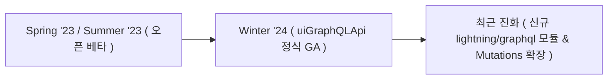

LWC(Lightning Web Components)로 커스텀 화면을 개발할 때 데이터를 가져오는 방식은 크게 두 갈래로 나뉩니다. 아주 단순한 단건 조회는 표준 와이어 어댑터(`getRecord`)를 쓰고, 조건 검색이나 부모·자식 관계 조회처럼 조금만 요건이 복잡해지면 습관처럼 **`@AuraEnabled` Apex 컨트롤러**를 새로 만드는 것이 현업의 오랜 공식이었습니다.

그런데 Salesforce가 공식 지원하는 제3의 선택지인 **LWC GraphQL**은 이름만 들어봤을 뿐 실제 프로젝트에서 적극적으로 쓰는 팀을 보기가 쉽지 않았습니다. 과연 GraphQL은 언제부터 지원되었고, 왜 그동안 잘 쓰이지 않았으며, **왜 최근 들어 다시 실무 도입 가치가 높아졌는지** 기존 `@AuraEnabled` 방식과 현실적으로 비교해 봅니다.

---

## 1. Salesforce에서 GraphQL은 언제부터 가능했을까?

원래 GraphQL은 REST API의 고질적인 문제인 **오버페칭(필요 없는 필드까지 통째로 받아오는 낭비)**과 **언더페칭(연관 데이터를 얻기 위해 API를 여러 번 호출하는 문제)**을 해결하기 위해 고안된 쿼리 언어입니다. 클라이언트가 *"나는 이 객체에서 딱 이 필드 3개와 하위 목록 5개만 필요해"*라고 요청하면 서버가 정확히 그 모양 그대로 데이터를 돌려줍니다.

Salesforce 플랫폼에 이 기능이 들어온 흐름은 다음과 같습니다.



- **도입기 (`2023년`, Spring '23 베타 ➔ `Winter '24` 정식 출시)**: `lightning/uiGraphQLApi` 와이어 어댑터가 정식(GA) 기능으로 출시되면서, Apex 코드 없이도 LWC 안에서 조건절(`where`), 정렬(`orderBy`), 부모·자식 관계 데이터를 조회할 수 있는 길이 열렸습니다.
- **성숙기 (최근 `lightning/graphql` 세대교체)**: 초기 모듈의 구조적 한계를 개선한 신규 **`lightning/graphql`** 모듈로 중심이 옮겨가면서 동적 쿼리 조립, Optional 필드 지원, 나아가 단순 조회(Query)뿐 아니라 레코드 생성·수정·삭제를 수행하는 **Mutations**까지 지원 범위가 넓어졌습니다.

---

## 2. 솔직히 그동안 현업에서 왜 잘 안 썼을까?

정식 출시된 지 꽤 시간이 지났음에도 국내외 많은 프로젝트에서 여전히 `@AuraEnabled` Apex만 고집했던 데에는 아주 현실적인 3가지 이유가 있었습니다.

### 1) SOQL에 익숙한 개발자에게 너무 낯선 중첩 문법
Apex에서는 `SELECT Id, Name FROM Account WHERE Rating = 'Hot'` 한 줄이면 끝나는 쿼리가, GraphQL에서는 `uiapi ➔ query ➔ Account ➔ edges ➔ node ➔ Name ➔ value` 식으로 깊게 파고드는 중첩 구조를 요구합니다. 결과 데이터를 꺼낼 때도 `map()`으로 껍질을 여러 겹 벗겨내야 해서 진입장벽과 타이핑 피로도가 높았습니다.

### 2) 초창기 모듈(`uiGraphQLApi`)의 아쉬운 제약사항
초기 버전에서는 조건에 따라 쿼리 문자열을 유연하게 바꾸는 동적 쿼리 구성이 까다로웠고, 오직 **읽기(Read) 전용**이었기 때문에 화면에 저장 버튼 하나만 추가되어도 결국 어차피 Apex 컨트롤러를 따로 만들어야 하는 반쪽짜리 느낌이 강했습니다. 또한 복잡한 집계 연산(`GROUP BY` 등)이나 대량 데이터 합산에는 한계가 뚜렷했습니다.

### 3) 익숙함의 관성
일정이 촉박한 SI나 운영 환경에서 개발자 입장에서는 *"낯선 GraphQL 스키마 문서 뒤져가며 삽질할 시간에, 손에 익은 `@AuraEnabled` Apex 메서드 하나 빨리 짜서 넘기자"*라는 판단이 훨씬 자연스러웠습니다.

---

## 3. 그런데 왜 '지금'은 다시 써볼 만해졌을까?

과거에 발목을 잡았던 단점들이 최근 두 가지 큰 변화와 맞물리면서 상황이 완전히 달라졌습니다.

1. **`lightning/graphql` 모듈의 완성도 향상**
   - 구버전 모듈을 대체하는 `lightning/graphql`이 도입되면서 동적 변수 바인딩과 선택적 필드(Optional Fields) 처리가 유연해졌고, **GraphQL Mutations** 지원으로 간단한 생성·수정·삭제까지 백엔드 코드 없이 완결할 수 있게 되었습니다.
2. **AI 코딩 도구가 지워버린 '문법 진입장벽'**
   - 사실 가장 결정적인 변화입니다. 과거 개발자들이 제일 귀찮아했던 `edges ➔ node ➔ value` 쿼리 작성과 응답 매핑 코드는 이제 AI 코딩 어시스턴트(특히 Salesforce 공식 문서의 `llms-lwc.txt` 인덱스와 결합했을 때)에게 *"Account와 하위 Contact 최근 5건을 가져오는 LWC GraphQL 코드 짜줘"*라고 하면 3초 만에 오타 없이 만들어 줍니다.
   - **작성할 때의 번거로움은 AI 덕분에 사라지고, 운영·배포 단계에서의 이점만 온전히 챙길 수 있는 환경**이 된 것입니다.

---

## 4. 기존 `@AuraEnabled` 컨트롤러 대비 확실한 실무 장점 4가지

그렇다면 굳이 멀쩡한 `@AuraEnabled` Apex 대신 LWC에서 GraphQL을 썼을 때 현업 개발자가 피부로 느끼는 실질적인 이득은 무엇일까요?

### 장점 1) Apex 테스트 클래스(75% 커버리지) 작성 해방 & 초고속 운영 배포 ⭐
실무에서 가장 체감이 큰 장점입니다.
- **기존 `@AuraEnabled` 방식**: 단순히 조건에 맞는 목록을 화면에 뿌려주는 작은 LWC 하나를 만들더라도 `MyController.cls`를 만들어야 하고, 운영(Production) 배포를 위해 가짜 테스트 데이터를 세팅하는 **`MyController_Test.cls`까지 세트로 작성**해야 합니다. 게다가 운영 배포 시 Apex가 포함되는 순간 조직의 테스트 실행 시간(수분~수십 분)을 기다려야 합니다.
- **GraphQL 방식**: 백엔드 Apex 파일이 **0개**입니다. 테스트 클래스를 짤 필요도 없고, 운영 환경에 LWC 번들 하나만 배포하면 **단 몇 초 만에 배포가 끝납니다.** 유지보수해야 할 서버 클래스 개수가 늘어나지 않아 Org 코드 베이스가 깔끔해집니다.

### 장점 2) Lightning Data Service(LDS) 캐시 자동 동기화
- `@AuraEnabled(cacheable=true)`로 가져온 데이터는 사용자가 같은 레코드 상세 페이지에서 필드를 수정하더라도 내 커스텀 LWC 화면에 자동으로 반영되지 않아 `refreshApex()`나 메시지 채널 이벤트를 별도로 구현해야 합니다.
- 반면 GraphQL 와이어 어댑터는 Salesforce **LDS(Lightning Data Service) 캐시 엔진 위에서 동작**합니다. 표준 화면이나 다른 컴포넌트에서 해당 레코드 값이 바뀌면 **추가 코드 한 줄 없이 내 LWC 화면의 값도 실시간으로 자동 갱신**됩니다.

### 장점 3) 보안(Sharing · CRUD · FLS) 기본 내장
- Apex 컨트롤러는 기본적으로 시스템 모드에서 돌기 때문에 개발자가 깜빡하고 `with sharing`이나 `WITH USER_MODE`를 빠뜨리면 권한 없는 사용자에게 민감한 필드가 노출되는 보안 사고로 이어집니다.
- GraphQL은 UI API 기반이므로 **현재 로그인한 사용자의 레코드 공유 권한과 필드 수준 보안(FLS)이 100% 자동으로 적용**됩니다. 권한이 없는 필드는 알아서 안전하게 걸러지므로 보안 감사(Security Review) 대응이 매우 편합니다.

### 장점 4) 단일 호출로 부모·자식 데이터를 정밀하게 조회
- 표준 `@wire(getRecord)`는 단건 위주라 조건부 목록 검색이나 하위 자식 리스트 조회가 불가능해 여러 번 호출을 쪼개야 했습니다.
- GraphQL은 **한 번의 네트워크 요청**으로 부모 필드와 하위 자식 목록 중 화면에 딱 필요한 필드만 골라 받아오므로 네트워크 페이로드가 가볍고 모바일·저사양 환경에서도 쾌적합니다.

> 코드 느낌만 간단히 비교해 보면, 별도의 `.cls` 파일과 `_Test.cls` 파일 없이 LWC JS 내부에서 아래처럼 쿼리 선언만으로 조회가 끝납니다.
{: .prompt-info }

```javascript
import { LightningElement, wire } from 'lwc';
import { gql, graphql } from 'lightning/graphql';

export default class HotAccountList extends LightningElement {
  @wire(graphql, {
    query: gql`
      query GetHotAccounts {
        uiapi {
          query {
            Account(where: { Rating: { eq: "Hot" } }, first: 10) {
              edges {
                node {
                  Id
                  Name { value }
                  Phone { value }
                }
              }
            }
          }
        }
      }
    `
  })
  wiredAccounts;
}
```

---

## 5. 한눈에 보는 실무 선택 기준: 언제 GraphQL을 쓰고, 언제 Apex를 쓸까?

물론 GraphQL이 만능은 아닙니다. 모든 `@AuraEnabled`를 대체하려 하기보다 **화면의 성격에 따라 명확한 기준**을 두고 골라 쓰는 것이 가장 현명합니다.

| 비교 항목 | LWC `lightning/graphql` 추천 상황 | 기존 `@AuraEnabled` Apex 추천 상황 |
| :--- | :--- | :--- |
| **주 목적** | **사용자 권한 그대로 화면용 데이터를 조회·단순 편집할 때** | **복잡한 서버 비즈니스 로직·가공·외부 연동이 섞여 있을 때** |
| **테스트 / 배포** | **테스트 클래스 없이 LWC만 수 초 만에 가볍게 배포** | `Test Class`(75% 이상) 필수 작성 및 Apex 배포 검증 수행 |
| **데이터 보안** | 로그인 유저의 Sharing / FLS 무조건 준수 | **`without sharing`으로 권한을 우회해 조회·집계해야 할 때 필수** |
| **화면 캐시 연동** | 표준 화면 수정 시 **자동 실시간 동기화 (LDS 통합)** | `refreshApex()` 등 수동 캐시 무효화 제어 필요 |
| **대량 연산** | 화면 표시용 페이지네이션 조회에 적합 | **수만 건 데이터 합산, 다중 객체 복합 트랜잭션 처리에 적합** |

---

## 마무리 요약

> **실무 도입 한 줄 정리**
> - 복잡한 비즈니스 연산이나 권한 우회(`without sharing`), 외부 API Callout이 필요한 화면이라면 주저 없이 기존처럼 **`@AuraEnabled` Apex**를 쓰면 됩니다.
> - 반대로 **"단순히 조건에 맞는 레코드와 연관 데이터를 예쁘게 조회해 보여주는 대시보드·위젯·관련 목록 LWC"**를 만들 때 매번 Apex 클래스와 테스트 클래스까지 세트로 찍어내고 있었다면, 이제는 **`lightning/graphql`**을 도입해 배포 속도와 유지보수 효율을 확 높여보시길 추천합니다.
{: .prompt-tip }
