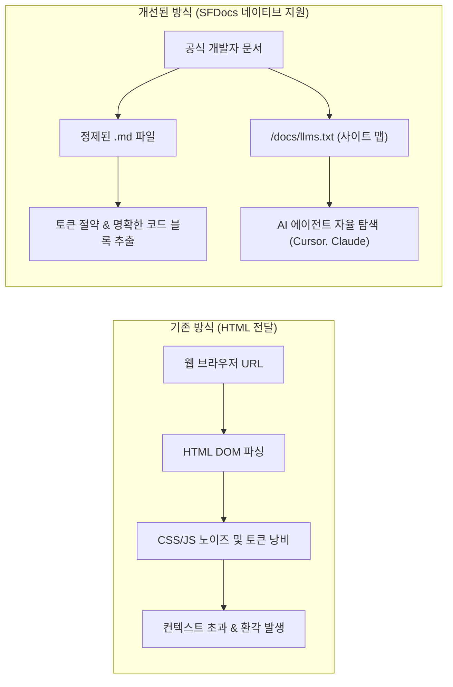

최근 Cursor, Claude Code, GitHub Copilot 등 AI 기반 코딩 도구가 개발 실무의 기본 환경으로 자리 잡았습니다. 하지만 Salesforce 생태계에서 LLM을 쓸 때 가장 큰 걸림돌은 **"LLM이 세일즈포스의 최신 문법(LWC 최신 기능, Apex 가버너 제한, Agentforce API 등)을 잘못 알고 환각(Hallucination)을 일으킨다"**는 점이었습니다. 

웹 문서 링크를 던져줘도 무거운 DOM 트리, 클라이언트 렌더링(CSR) 자바스크립트 스크립트, 상단/하단 내비게이션 바 같은 불필요한 HTML 노이즈 때문에 토큰(Token)만 낭비되고 정작 핵심 로직은 프롬프트 컨텍스트에서 잘려 나가기 일쑤였습니다.

Salesforce 개발자 공식 블로그의 [Bring Salesforce Developer Docs into Your AI Tools](https://developer.salesforce.com/blogs/2026/11/bring-salesforce-developer-docs-into-your-ai-tools) 아티클에 따르면, 최근 Salesforce Developers 포털 전반에 AI 도구를 위한 네이티브 연동 기능(`Copy as Markdown`, `llms.txt`, 원클릭 프롬프트)이 공식 탑재되었습니다. 

현업 프로젝트에서 이를 어떻게 IDE(Cursor, VS Code)와 AI 에이전트 워크플로우에 결합해 환각 없는 코드를 뽑아낼 수 있는지 실무 관점에서 정리해 보겠습니다.

---

## 1. 기존 웹 스크래핑 방식의 한계와 새로운 변화

과거 공식 문서를 AI에 참조시킬 때 마주쳤던 구조적 문제와 이번 개편의 핵심 차이는 다음과 같습니다.



### 왜 마크다운(.md)과 llms.txt인가?
1. **토큰 최적화**: 웹페이지 전체 HTML을 AI에 넣으면 불필요한 태그와 스타일 정보로 인해 수천 토큰이 즉시 소모됩니다. 마크다운은 순수 텍스트와 코드 블록(` ``` `)만 남기므로 LLM의 유효 컨텍스트 윈도우를 70% 이상 절약합니다.
2. **코드 블록 식별성**: 웹페이지 텍스트를 드래그 앤 드롭으로 붙여넣으면 들여쓰기(Indentation)가 깨지거나 인라인 코드가 일반 텍스트로 합쳐져 컴파일 에러를 유발합니다. 전용 마크다운은 언어 식별자(apex, js, html)를 온전히 보존합니다.
3. **`llms.txt` 표준 지원**: `llms.txt`는 대규모 사이트의 구조를 LLM이 빠르게 탐색할 수 있도록 요약된 디렉터리 색인 표준입니다. Salesforce는 40개 이상의 핵심 제품군(Apex, LWC, Agentforce, Data Cloud 등)에 대한 엔드포인트를 제공합니다.

---

## 2. 실무 활용 3단계 시나리오

공식 문서 상단 툴바에 추가된 액션 버튼들을 일상적인 개발 작업 흐름에 녹여내는 방법입니다.

### 시나리오 A: IDE 시스템 프롬프트(Rules)에 공식 문서 주입하기
Cursor나 VS Code의 Roo Code, Cline 등을 사용할 때 `.cursorrules` 또는 프로젝트 지침 파일에 Salesforce 공식 문서의 마크다운 엔드포인트를 지정할 수 있습니다.

```markdown
<!-- .cursorrules 예시 설정 -->
You are a senior Salesforce developer.
Always refer to the official latest Salesforce documentation when generating LWC or Apex:
- Main Reference: https://developer.salesforce.com/docs/llms.txt
- LWC Context API: https://developer.salesforce.com/docs/platform/lwc/guide/use-context.md

Rules:
1. Adhere strictly to Apex Governor Limits (No SOQL/DML in loops).
2. For LWC wire adapters, use the latest standard modules.
```

> **단축 URL 팁**: 공식 문서 URL 끝의 `.html`을 `.md`로 변경하면 빌드 시스템(SFDocs)에서 사전 생성된 순수 마크다운 원본을 바로 내려받을 수 있습니다.
{: .prompt-tip }

### 시나리오 B: 복잡한 비즈니스 로직 작성 시 실시간 프롬프팅
문서 상단의 `More actions (⋯)` 메뉴에서 `Open in Claude`나 `Open in ChatGPT`를 클릭하면, 현재 페이지 URL과 `llms.txt` 인덱스가 포함된 사전 정의 프롬프트가 즉시 생성됩니다.

여기에 실무 요구사항만 덧붙여 질문하면 최신 사양을 준수하는 코드를 얻을 수 있습니다.

```text
[자동 완성된 기본 프롬프트]
I'm reading "Make a Component Aware of Its Context" at 
https://developer.salesforce.com/docs/platform/lwc/guide/use-context.html. 
Read this page so I can ask questions about it. For broader context, 
see https://developer.salesforce.com/docs/llms.txt

[엔지니어 추가 프롬프트 예시]
위 문서를 바탕으로, 레코드 페이지의 현재 RecordId와 ObjectApiName을 동적으로 주입받아
Account와 Contact 간 관계를 조회하는 실무용 LWC 컴포넌트 컨트롤러 코드를 작성해 줘.
- 에러 처리는 LightningAlert 표준 컴포넌트를 사용할 것
- Apex 호출 시 캐싱 옵션(cacheable=true)을 충실히 반영할 것
```

### 시나리오 C: cURL 기반 CI/CD 파이프라인 및 사내 RAG 문서 동기화
사내 Private LLM이나 전용 AI 챗봇을 운영 중인 SI/엔터프라이즈 환경이라면, 정기 배치 스크립트로 최신 문서를 크롤링할 때 무거운 HTML 파서(Puppeteer, Beautiful Soup) 대신 직접 마크다운을 다운로드하여 벡터 DB에 인덱싱할 수 있습니다.

```bash
#!/bin/bash
# Salesforce 최신 문서 마크다운 수집 스크립트 예시
TARGET_DIR="./docs-sync"
mkdir -p $TARGET_DIR

# 1. 메인 llms.txt 확인
curl -s https://developer.salesforce.com/docs/llms.txt > $TARGET_DIR/main-index.txt

# 2. 특정 최신 기능 문서의 순수 마크다운 다운로드 (HTML 태그 없는 상태)
curl -s https://developer.salesforce.com/docs/platform/lwc/guide/use-context.md -o $TARGET_DIR/use-context.md

echo "Salesforce Markdown 문서 수집 완료 (RAG 임베딩 준비 완료)"
```

---

## 3. 실무 도입 시 반드시 고려해야 할 제약과 함정

이 기능이 모든 개발자 문서에 만능으로 동작하는 것은 아닙니다. 실무 워크플로우를 구성하기 전에 아래 한계점들을 체크해야 합니다.

| 구분 | 지원 여부 | 실무 시 대응 방안 |
| :--- | :--- | :--- |
| **다국어 페이지** | 미지원 (영문 전용) | 번역본(ko) URL에서는 버튼이 안 뜨므로 `/en-us/` 원문 페이지에서 호출 |
| **API Reference 페이지** | 일부 미지원 | Swagger/OpenAPI 스펙 기반 자동 렌더링 문서는 `.md` 파일이 없을 수 있음 |
| **AI 도구의 Web Access** | 필수 요구 | 'Open in ...' 사용 시 LLM 서비스 계정에 웹 브라우징 권한이 켜져 있어야 함 |
| **LLM 지식 차단(Air-Gapped)** | 오프라인 환경 한계 | 폐쇄망 환경에서는 `Copy as Markdown`을 눌러 클립보드로 직접 복사 전달 |

> **LLM 환각 방지 경고**:
> `Open in ChatGPT/Claude` 액션은 본문 텍스트를 클립보드로 직접 밀어 넣는 것이 아니라 URL 링크를 프롬프트로 전달합니다. 만약 사용하는 도구가 실시간 웹 검색(Web Search) 기능을 지원하지 않거나 엔터프라이즈 정책상 차단되어 있다면 링크 내용을 읽지 못하고 모델의 과거 학습 데이터로만 답을 지어내므로 주의해야 합니다.
{: .prompt-warning }

---

## 4. 실무 생산성 향상 체크리스트

1. [ ] **공식 문서 북마크 정리**: 자주 참고하는 LWC Guide 및 Apex Reference URL의 뒤를 `.md`로 붙여보는 습관을 들인다.
2. [ ] **Cursor / Windsurf 지침 파일 갱신**: 프롬프트 규칙 파일에 `https://developer.salesforce.com/docs/llms.txt`를 외부 레퍼런스로 명시한다.
3. [ ] **레거시 스크래핑 방식 폐기**: 사내 RAG 파이프라인 구축 시 HTML 태그 정제 스크립트를 제거하고 직접 `.md` 소스를 활용하도록 전환한다.
4. [ ] **영문 원문 우선 열람**: 브라우저 기본 로케일이 한국어로 설정되어 자동 번역 페이지가 열린다면, AI 액션을 위해 최상단 로케일을 `English`로 변경해 작업한다.

Salesforce 개발 생태계가 Agentforce를 필두로 AI 친화적인 플랫폼으로 빠르게 전환되고 있는 만큼, 개발자가 공식 문서를 소비하는 방식 역시 최신 마크다운 표준과 `llms.txt`를 결합하여 더 가볍고 똑똑하게 전환할 때입니다.
